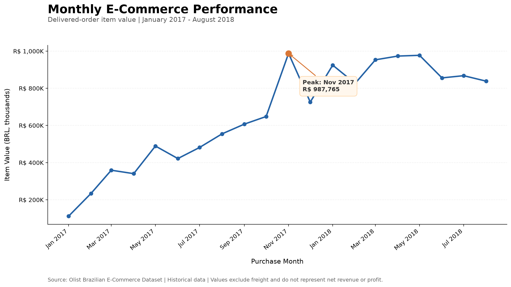
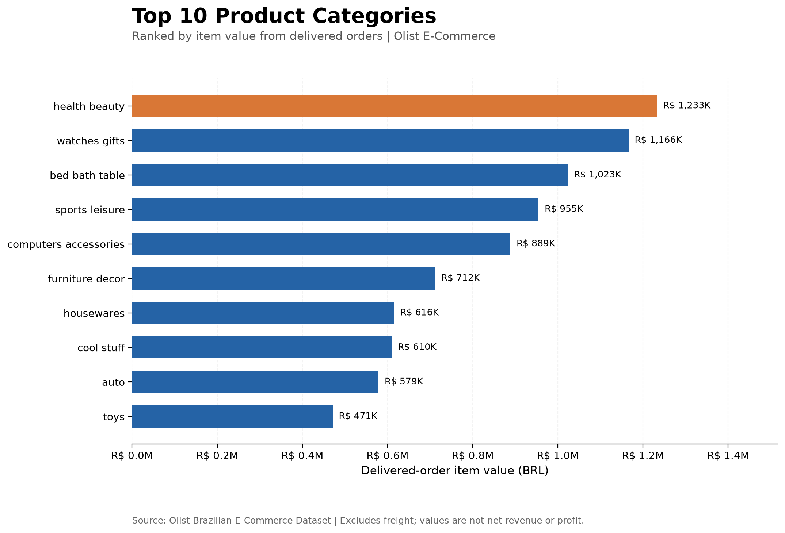

# E-Commerce Intelligence

**End-to-End Data Analytics & Data Engineering Portfolio Project**

An end-to-end e-commerce analytics project built using the Brazilian E-Commerce Public Dataset by Olist.

The project combines relational data modeling, Python-based data ingestion, PostgreSQL, automated data quality checks, SQL business analysis, and executive visualizations.

**Project Status:** In Progress

## 1. Project Objectives

The goal is to transform historical transactional data into reliable, business-oriented insights while demonstrating practical Data Analytics and Data Engineering skills.

Key business questions include:

- How does e-commerce activity evolve over time?
- Which product categories contribute the most value?
- How does order volume relate to monetary performance?
- Which geographic regions generate the most business activity?
- How efficiently are orders delivered?
- How do delivery delays relate to customer satisfaction?

## 2. Technology Stack

| Technology | Purpose |
|---|---|
| Python | Data ingestion, validation, and visualization |
| Pandas | Data exploration and transformation |
| PostgreSQL | Relational data storage and integrity |
| SQL | Business metrics and analytical queries |
| Matplotlib | Executive visualizations |
| Pytest | Automated testing |
| Ruff | Python linting and formatting |
| Git & GitHub | Version control |

## 3. Data Architecture

The current workflow consists of:

1. **Source Data:** Historical Olist CSV files.
2. **Data Exploration:** Dataset structure, missing values, anomalies, and referential integrity checks.
3. **Data Ingestion:** Python scripts load validated data into PostgreSQL.
4. **Relational Modeling:** Primary keys and foreign keys enforce data integrity.
5. **Business Analysis:** SQL queries calculate business indicators.
6. **Visualization:** Python generates executive charts from PostgreSQL results.
7. **Quality Assurance:** Automated tests and code quality checks support reliability.

### Implemented Database Tables

| Table | Description | Records |
|---|---|---:|
| `customers` | Customer and location information | 99,441 |
| `orders` | Order status and timestamps | 99,441 |
| `order_items` | Products and monetary values associated with orders | 112,650 |
| `products` | Product catalog and attributes | 32,951 |
| `product_categories` | Portuguese-to-English category translations | 71 |

Relationships:

- `orders.customer_id` references `customers.customer_id`.
- `order_items.order_id` references `orders.order_id`.
- `order_items.product_id` references `products.product_id`.

Product category translations are currently combined using a left join to preserve untranslated categories.

## 4. Business Analysis

### 4.1 Overall Business Performance

The current analysis focuses on delivered orders and item values, excluding freight.

| KPI | Result |
|---|---:|
| Total orders | 99,441 |
| Delivered orders | 96,478 |
| Delivery completion rate | 97.02% |
| Delivered-order item value | R$ 13,221,498.11 |
| Average delivered-order item value | R$ 137.04 |
| Delivered order items | 110,197 |

**Metric definition:** Item value represents the sum of product prices associated with orders marked as delivered. It is not equivalent to collected payments, net revenue, or profit.

### 4.2 Monthly E-Commerce Performance

The analysis examines delivered-order item value grouped by purchase month.



**Key findings:**

- November 2017 recorded the highest monthly delivered-order item value, approximately **R$ 987,765**.
- This represented a **52.37% increase** compared with October 2017.
- The main visualization covers January 2017 through August 2018.

The dataset contains sparse activity in parts of 2016. Month-over-month comparisons require consecutive calendar months, and unusually small monthly baselines must be interpreted cautiously.

### 4.3 Product Category Performance

Product category performance is measured using delivered-order item values, excluding freight.



**Key findings:**

- `health_beauty` ranks first with approximately **R$ 1.23 million** in item value.
- `watches_gifts` ranks second with approximately **R$ 1.17 million**.
- `bed_bath_table` ranks third with approximately **R$ 1.02 million**.
- The top five categories account for approximately **39.83%** of total delivered-order item value.
- `bed_bath_table` appears in more delivered orders than `health_beauty`, illustrating that order volume and monetary contribution are different measures.

Category order counts use distinct orders within each category. A single order may contribute to multiple categories.

## 5. Data Quality Findings

Data quality checks are an essential part of this project.

### Product Catalog

- 32,951 products loaded successfully.
- No duplicate product IDs were identified.
- All product IDs referenced by order items were present in the catalog.
- 610 products have no assigned category.
- Two category names lack English translations, affecting 13 products in the source catalog.

Missing categories are preserved and labeled `Uncategorized` in analytical outputs. Untranslated categories retain their original names.

### Order Data

Initial exploration identified missing delivery-related timestamps and cases where the recorded delivery timestamp precedes the carrier handoff timestamp.

Source data is preserved. Problematic records are handled according to the requirements of each analytical metric rather than silently corrected or deleted.

### Referential Integrity

PostgreSQL primary keys and foreign keys enforce key relationships between customers, orders, order items, and products.

Analytical reconciliation confirmed that joining delivered order items with the product catalog preserves the overall delivered-order item value of **R$ 13,221,498.11**.

## 6. Project Structure

```text
ecommerce-intelligence/
├── data/
│   ├── raw/
│   └── processed/
├── notebooks/
├── reports/
│   └── figures/
│       ├── monthly_sales_executive.png
│       └── top_categories.png
├── sql/
│   ├── 01_create_tables.sql
│   ├── 02_business_kpis.sql
│   ├── 03_monthly_sales.sql
│   ├── 04_create_product_tables.sql
│   ├── 05_add_product_relationship.sql
│   └── 06_category_performance.sql
├── src/
│   ├── load_data.py
│   ├── load_products.py
│   ├── visualize_sales.py
│   └── visualize_categories.py
├── tests/
├── README.md
└── requirements.txt
```

Additional scripts support initial exploration, anomaly investigation, and data validation.

## 7. Reproducing the Project

### Prerequisites

- Python with the project dependencies installed
- PostgreSQL
- Access to the original Olist CSV dataset

### Source Data

Download the [Brazilian E-Commerce Public Dataset by Olist](https://www.kaggle.com/datasets/olistbr/brazilian-ecommerce) and place the original CSV files inside `data/raw/`.

The source CSV files are not committed to this repository.

### Database Setup

Create a PostgreSQL database and application user with the appropriate permissions.

The scripts currently expect the following local connection settings:

- Database: `ecommerce_db`
- User: `ecommerce_user`
- Host: `localhost`

Database credentials are requested interactively rather than stored in source code.

Create the base schema:

```bash
psql -h localhost -U ecommerce_user -d ecommerce_db \
  -f sql/01_create_tables.sql
```

Create the product tables:

```bash
psql -h localhost -U ecommerce_user -d ecommerce_db \
  -f sql/04_create_product_tables.sql
```

Load the product catalog **before** loading order items:

```bash
python src/load_products.py
```

Apply the product relationship migration:

```bash
psql -h localhost -U ecommerce_user -d ecommerce_db \
  -f sql/05_add_product_relationship.sql
```

Load customer, order, and order-item data:

```bash
python src/load_data.py
```

These instructions describe the intended setup order. A fully automated reconstruction and isolated integration test are still planned.

### Running Analyses

```bash
psql -h localhost -U ecommerce_user -d ecommerce_db \
  -f sql/02_business_kpis.sql

psql -h localhost -U ecommerce_user -d ecommerce_db \
  -f sql/03_monthly_sales.sql

psql -h localhost -U ecommerce_user -d ecommerce_db \
  -f sql/06_category_performance.sql
```

### Generating Visualizations

```bash
python src/visualize_sales.py
python src/visualize_categories.py
```

### Running Quality Checks

```bash
ruff check src/ tests/
ruff format --check src/ tests/
python -m pytest tests/ -v
```

**Current automated test status:** 12 passing tests.

## 8. Known Limitations

- The dataset represents historical Brazilian e-commerce activity and does not describe current market conditions.
- Monetary indicators based on item prices exclude freight and do not represent net revenue or profit.
- Category information and translations are incomplete for some products.
- The current loader's existing-row check relies on row counts, not full content reconciliation.
- The `--reload` workflow has not yet been validated through an isolated end-to-end integration test.
- Database configuration is currently designed for a local PostgreSQL setup.

## 9. Next Steps

Planned development includes:

- Geographic order analysis.
- Delivery performance and SLA analysis.
- Customer satisfaction and review analysis.
- Customer retention and cohort analysis.
- A consolidated executive dashboard.
- Expanded integration testing and reproducible pipeline orchestration.

## 10. Dataset Attribution

**Dataset:** Brazilian E-Commerce Public Dataset by Olist

**Source:** https://www.kaggle.com/datasets/olistbr/brazilian-ecommerce

This project is an independent educational and professional portfolio project based on publicly available historical data.