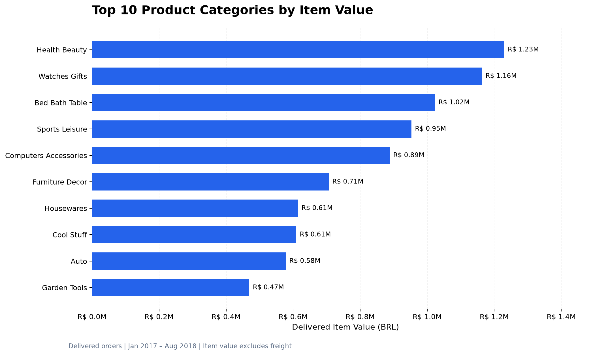
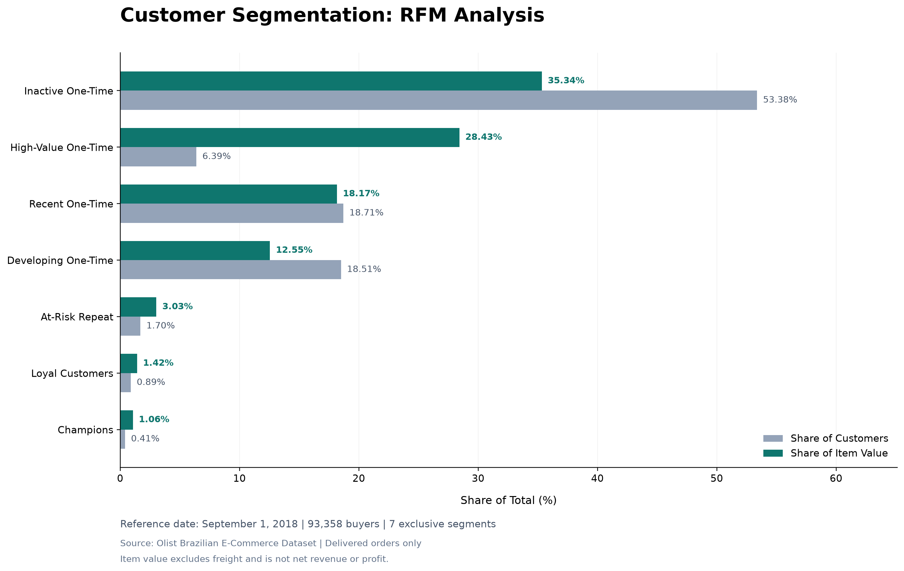
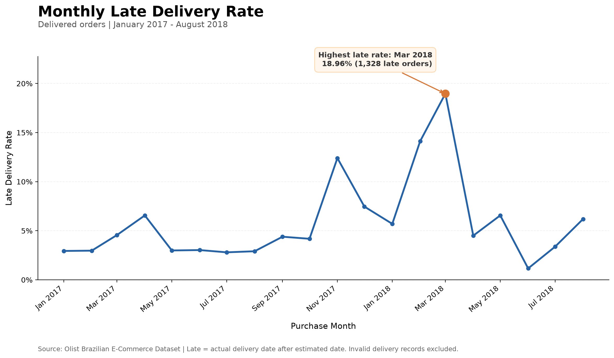
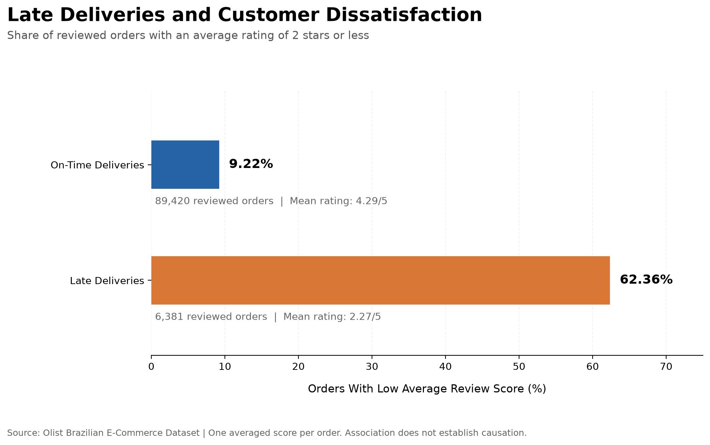
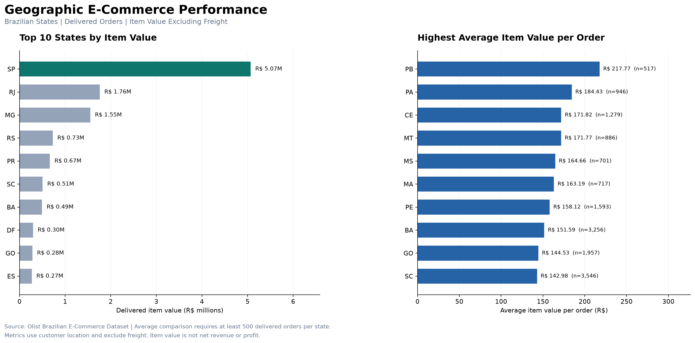
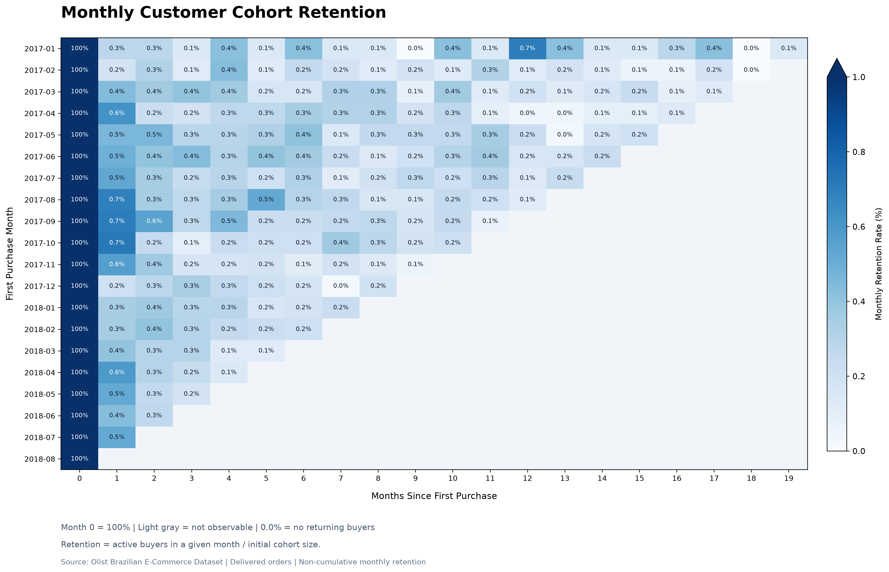
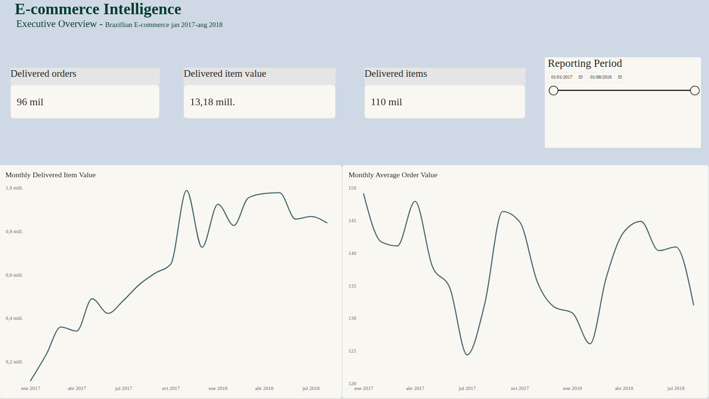

# E-Commerce Intelligence

**End-to-End Data Analytics & Data Engineering | Python · SQL · PostgreSQL · Power BI**

An end-to-end analytics project transforming historical Brazilian e-commerce transactions into validated business insights, automated data pipelines, and interactive reporting.

Based on the [Brazilian E-Commerce Public Dataset by Olist](https://www.kaggle.com/datasets/olistbr/brazilian-ecommerce).

## Project Highlights

| Metric | Result |
|---|---:|
| Delivered orders (full history) | **96,478** |
| Delivered item value (full history) | **R$ 13.22M** |
| Automated data quality checks | **9/9 passed** |
| Automated Python tests | **63 passed** |

## What This Project Demonstrates

- **Data Engineering:** PostgreSQL relational modeling, data ingestion, analytical views, automated pipelines, and atomic CSV exports.
- **Data Analytics:** SQL-driven commercial analysis, delivery performance, customer retention, RFM segmentation, and category performance.
- **Business Intelligence:** Interactive Power BI reporting, executive KPIs, monthly trends, and date filtering.
- **Data Quality:** Metric reconciliation, validation gates, automated testing, and reproducible workflows.

## Selected Visualizations

**Monthly E-Commerce Performance**


**Top 10 Product Categories — BI Reporting Period**



**Customer RFM Segmentation**



## Technical Architecture

`Olist CSVs → Python Ingestion → PostgreSQL → SQL Analytics & Data Mart → Quality Gate → Automated Exports → Matplotlib / Power BI`

**Current implementation:** Six analytical modules, five automated CSV exports, eight portfolio visualizations, and an interactive Power BI executive report.

**Reporting scope:** Historical data. Executive BI metrics cover January 2017–August 2018; full-history results are identified separately. Delivered item value excludes freight and is not net revenue or profit.

---

## 1. Project Overview

The objective is to demonstrate practical Data Analytics and Data Engineering skills through a structured e-commerce data workflow.

The project combines:

- Data exploration and quality assessment
- Python-based data ingestion
- PostgreSQL relational modeling
- SQL business analysis
- Executive data visualization
- Customer retention and segmentation
- Analytics data mart development
- Automated SQL exports and pipeline orchestration
- Data quality gates and atomic CSV exports
- Automated testing
- Business insight communication

### Business Questions

1. How has e-commerce activity evolved over time?
2. Which product categories contribute the most monetary value?
3. How efficiently are orders delivered?
4. Are late deliveries associated with lower customer satisfaction?
5. Which geographic regions generate the most business activity?
6. How do customer retention and purchasing patterns evolve?
7. Which customers contribute the most monetary value, and how can their purchasing behavior be segmented?

All seven questions have been investigated through six analytical modules.

An analytics data mart, five automated CSV exports, an automated category visualization, and a quality gate have been implemented.

A Power BI web executive report with three KPI cards, two monthly line charts, and an interactive date slicer is working.

Multi-dataset integration and full end-to-end database reconstruction remain planned.

---

## 2. Technology Stack

| Technology | Purpose |
|---|---|
| Python | Data ingestion, pipeline orchestration, validation, and visualization |
| Pandas | Data exploration and transformation |
| PostgreSQL | Relational storage, analytical views, and integrity constraints |
| SQL | Business analytics, data mart queries, and KPI calculations |
| Psycopg | PostgreSQL connectivity and analytical exports |
| Matplotlib | Executive visualizations |
| NumPy | Numerical validation and cohort matrices |
| Pytest | Automated testing and failure simulation |
| Ruff | Python linting and formatting |
| Git & GitHub | Version control |
| Power BI (web) | Interactive executive report using the monthly BI export |

---

## 3. Data Architecture

The project follows a modular architecture that separates source data, relational storage, business analysis, analytical outputs, and quality assurance.

### 3.1 Data Workflow

1. **Source Data:** Historical Olist CSV files.
2. **Data Exploration:** Schema inspection, missing values, duplicates, and anomalies.
3. **Data Ingestion:** Python scripts load source data into PostgreSQL.
4. **Relational Modeling:** Primary and foreign keys enforce integrity.
5. **Business Analysis:** SQL queries calculate operational and commercial metrics.
6. **Analytics Data Mart:** An order-level SQL view provides reusable commercial measures.
7. **Data Quality:** SQL checks reconcile business metrics and validate analytical structure.
8. **Pipeline Orchestration:** Python coordinates read-only SQL exports and visualizations.
9. **BI Export:** Validated datasets are generated for downstream reporting.
10. **Quality Assurance:** Pytest and Ruff support code reliability.

### 3.2 Implemented Database Tables

| Table | Description | Records |
|---|---|---:|
| `customers` | Customer and location information | 99,441 |
| `orders` | Order status and timestamps | 99,441 |
| `order_items` | Products and item-level monetary values | 112,650 |
| `products` | Product catalog and attributes | 32,951 |
| `product_categories` | Category translations | 71 |
| `reviews` | Customer review records | 99,224 |

### 3.3 Referential Integrity

The relational model includes:

- `orders.customer_id` references `customers.customer_id`.
- `order_items.order_id` references `orders.order_id`.
- `order_items.product_id` references `products.product_id`.
- `reviews.order_id` references `orders.order_id`.

The `reviews` table uses an internal primary key because source `review_id` values are not unique.

Product category translations are joined using the original category names. Missing translations are preserved rather than discarded.

For retention and segmentation analyses, `customer_unique_id` identifies distinct buyers across multiple order-specific customer records.

### 3.4 Analytics Data Mart

The project includes the PostgreSQL view:

`analytics_order_summary`

The view combines delivered orders, customer attributes, and aggregated order-item metrics.

**Grain:** One row per delivered order.

**Included Dimensions and Metrics**

- Order identifier
- Unique buyer identifier
- Customer state and city
- Order status
- Purchase timestamp and purchase month
- Actual and estimated delivery timestamps
- Number of order items
- Delivered-order item value
- Freight value
- Basic late-delivery indicator

Order items are aggregated before joining them to the order-level dataset. This avoids duplicating orders when a transaction contains multiple products.

**Data Mart Reconciliation**

| Metric | Result |
|---|---:|
| Delivered orders | 96,478 |
| Delivered order items | 110,197 |
| Delivered-order item value | R$ 13,221,498.11 |
| Unique buyers | 93,358 |
| Geographic units | 27 |

The view uses delivered orders with nonmissing purchase timestamps.

Its monetary item-value measure excludes freight and does not represent collected payments, net revenue, or profit.

The basic late-delivery flag does not replace the stricter delivery eligibility rules used in the dedicated delivery-performance analysis.

### 3.5 Automated Analytical Pipeline

The Python orchestrator is implemented in:

`src/run_pipeline.py`

It coordinates:

1. PostgreSQL connectivity and required-file checks.
2. Execution of the BI data mart quality gate.
3. Customer cohort CSV export and heatmap generation.
4. Customer RFM CSV export and visualization.
5. Monthly BI sales CSV export.
6. Executive KPI CSV export.
7. Product-category BI CSV export and Top 10 chart generation.

**Current Automated Exports**

| Dataset | Output |
|---|---|
| Monthly customer cohorts | `data/processed/customer_cohorts.csv` |
| RFM customer segments | `data/processed/customer_rfm_segments.csv` |
| Monthly BI sales | `data/processed/bi_monthly_sales.csv` |
| Executive BI KPIs | `data/processed/bi_executive_kpis.csv` |
| BI product categories | `data/processed/bi_category_performance.csv` |

The pipeline uses read-only PostgreSQL connections and atomic CSV replacement.

It automatically generates the cohort heatmap, RFM visualization, and BI Top 10 product categories chart.

Each CSV is written to a temporary file before replacing its final destination.

If an individual export fails before replacement, the existing CSV is preserved.

If the BI quality gate fails, the pipeline stops before starting analytical exports.

Atomic replacement applies to individual CSV files, not to the entire multi-step pipeline.

---

## 4. Business Analysis

### 4.1 Overall E-Commerce Performance

The analysis focuses on delivered orders and item values, excluding freight.

| KPI | Result |
|---|---:|
| Total orders | 99,441 |
| Delivered orders | 96,478 |
| Delivery completion rate | 97.02% |
| Delivered-order item value | R$ 13,221,498.11 |
| Average delivered-order item value | R$ 137.04 |
| Delivered order items | 110,197 |

**Metric definition:** Delivered-order item value is the sum of product prices associated with orders marked as delivered.

It does not represent collected payments, net revenue, or profit.

### 4.2 Monthly E-Commerce Performance

Monthly performance is calculated using the purchase month of delivered orders.


**Key Findings**

- November 2017 recorded the highest monthly delivered-order item value: approximately **R$ 987,765**.
- This represented a **52.37% increase** compared with October 2017.
- The main visualization covers January 2017 through August 2018.

The dataset contains sparse activity in parts of 2016. Month-over-month growth is calculated only when consecutive calendar months are available.

### 4.3 Product Category Performance

Product categories are ranked by the value of items associated with delivered orders.


**Full-History Key Findings**

- `health_beauty` leads with approximately **R$ 1.23 million**.
- `watches_gifts` follows with approximately **R$ 1.17 million**.
- `bed_bath_table` ranks third with approximately **R$ 1.02 million**.
- The five leading categories account for approximately **39.83%** of delivered-order item value.
- `bed_bath_table` appears in more delivered orders than `health_beauty`, demonstrating that order volume and monetary contribution measure different aspects of performance.

Category-level order counts use distinct orders within each category.

An order containing products from multiple categories may contribute to multiple category counts.

#### BI Reporting-Period Category Analysis

**Reporting period:** January 2017 through August 2018.

The BI dataset generated by `sql/20_bi_category_performance.sql` joins order items to `analytics_order_summary`, using the same purchase-month boundaries as monthly sales.

This reporting-period dataset is distinct from the complete historical category analysis.


**Top 10 Product Categories by Delivered Item Value**

| Rank | Category | Item Value (BRL) |
|---:|---|---:|
| 1 | `health_beauty` | R$ 1,229,557.50 |
| 2 | `watches_gifts` | R$ 1,163,465.91 |
| 3 | `bed_bath_table` | R$ 1,022,955.77 |
| 4 | `sports_leisure` | R$ 952,840.40 |
| 5 | `computers_accessories` | R$ 888,055.59 |
| 6 | `furniture_decor` | R$ 706,237.17 |
| 7 | `housewares` | R$ 614,341.62 |
| 8 | `cool_stuff` | R$ 609,158.00 |
| 9 | `auto` | R$ 577,838.39 |
| 10 | `garden_tools` | R$ 469,135.40 |

**Validated Results**

| Metric | Result |
|---|---:|
| Reporting months | 20 |
| Product categories | 74 |
| Delivered item value | R$ 13,181,027.13 |
| Reconciliation difference | R$ 0.00 |
| Leading category | `health_beauty` |

The category dataset and monthly BI dataset reconcile exactly to **R$ 13,181,027.13**.

Category-level order counts remain non-additive across categories.

Category shares refer to the entire 20-month BI reporting period, not to a date-slicer-selected subperiod.

### 4.4 Delivery Performance

Delivery performance is evaluated using delivered orders with valid purchase, estimated delivery, and actual delivery timestamps.

An order is considered late when its actual delivery calendar date is after the estimated delivery calendar date.



**Overall Delivery KPIs**

| Metric | Result |
|---|---:|
| Valid delivered orders | 96,447 |
| On-time orders | 89,913 |
| Late orders | 6,534 |
| On-time delivery rate | 93.23% |
| Late delivery rate | 6.77% |
| Average purchase-to-delivery time | 12.56 days |
| Average delay among late deliveries | 11.30 days |

**Key Findings**

- Most valid delivered orders arrived on or before their estimated delivery dates.
- March 2018 recorded the highest monthly late-delivery rate in the analyzed period: **18.96%**.
- February 2018 also showed elevated delays at **14.13%**.
- June 2018 recorded a substantially lower monthly late-delivery rate of **1.16%**.

The monthly visualization covers January 2017 through August 2018.

The monthly population contains **96,184 valid orders**, while the overall delivery analysis includes 96,447 valid orders.

Orders with missing actual delivery dates or inconsistent chronological sequences are excluded from these metrics without modifying the source data.

### 4.5 Delivery Performance and Customer Satisfaction

This analysis investigates whether late deliveries are associated with lower customer review scores.

Because some orders contain multiple review records, scores are averaged at the order level before comparing delivery groups.



**Results**

| Metric | On-Time Deliveries | Late Deliveries |
|---|---:|---:|
| Reviewed orders | 89,420 | 6,381 |
| Average review score | 4.29 / 5 | 2.27 / 5 |
| Orders with low average scores (≤ 2) | 9.22% | 62.36% |

**Key Findings**

- Late deliveries are associated with substantially lower review scores.
- The difference in average ratings is **2.02 stars**.
- Low-rating rates differ by **53.14 percentage points**.
- Low ratings are approximately **6.8 times as common** among late deliveries.

This is an observational association, not evidence that delivery delays alone cause negative customer reviews.

**Sensitivity Analysis**

A separate analysis excluded orders with multiple reviews.

| Metric | On-Time Deliveries | Late Deliveries |
|---|---:|---:|
| Orders with exactly one review | 88,923 | 6,353 |
| Average review score | 4.29 | 2.27 |
| Low-rating rate | 9.24% | 62.36% |

The results remained nearly identical, suggesting that the main association is not driven primarily by orders with multiple review records.

### 4.6 Geographic Sales Performance

Geographic performance is analyzed using the customer state associated with each delivered order.

The analysis combines `customers`, `orders`, and `order_items` to calculate delivered-order counts and item values by Brazilian state.

Order-level item values are aggregated before calculating state-level metrics to prevent orders containing multiple items from being counted more than once.



**Geographic Coverage**

- **27** Brazilian states and federal units represented.
- **96,478** delivered orders analyzed.
- **110,197** delivered order items.
- **R$ 13,221,498.11** in total delivered-order item value.

**Top 5 States by Delivered Item Value**

| State | Delivered Orders | Item Value | Value Share |
|---|---:|---:|---:|
| São Paulo (SP) | 40,501 | R$ 5,067,633.16 | 38.33% |
| Rio de Janeiro (RJ) | 12,350 | R$ 1,759,651.13 | 13.31% |
| Minas Gerais (MG) | 11,354 | R$ 1,552,481.83 | 11.74% |
| Rio Grande do Sul (RS) | 5,345 | R$ 728,897.47 | 5.51% |
| Paraná (PR) | 4,923 | R$ 666,063.51 | 5.04% |

**Key Findings**

- São Paulo represents **41.98% of delivered orders** but **38.33% of delivered item value**.
- São Paulo, Rio de Janeiro, and Minas Gerais collectively account for approximately **63.38%** of delivered item value.
- Geographic activity is highly concentrated in a small number of states.
- High order volume does not necessarily correspond to high average item value per order.

**Average Item Value per Delivered Order**

| State | Delivered Orders | Average Item Value |
|---|---:|---:|
| Paraíba (PB) | 517 | R$ 217.77 |
| Ceará (CE) | 1,279 | R$ 171.82 |
| Pernambuco (PE) | 1,593 | R$ 158.12 |
| Bahia (BA) | 3,256 | R$ 151.59 |
| São Paulo (SP) | 40,501 | R$ 125.12 |

Paraíba has a substantially higher average item value per delivered order than São Paulo, despite representing a much smaller share of total activity.

**Analytical Considerations**

The visualization of states with the highest average item value uses a minimum threshold of **500 delivered orders per state**.

This threshold reduces the emphasis on very small samples but does not guarantee statistical stability or establish commercial attractiveness.

Customer location is used as a geographic approximation of purchasing activity. It does not represent seller location, product origin, or the location where payment was processed.

These findings support further investigation of regional demand, order composition, product categories, and logistics before making geographic expansion recommendations.

### 4.7 Customer Retention and Cohort Analysis

Customer retention is investigated through two complementary approaches:

1. **Repeat Purchase Analysis:** Identifying buyers with multiple delivered orders during the full observed period.
2. **Monthly Cohort Retention:** Measuring purchasing activity in calendar months following each buyer's first delivered order.

The analysis uses `customer_unique_id` rather than `customer_id` to identify buyers across different orders.

Only delivered orders are included.

#### Repeat Purchase Analysis

The repeat purchase analysis calculates the number of distinct buyers, their purchase frequency, and the proportion who placed multiple delivered orders.

**Customer Purchase Behavior KPIs**

| Metric | Result |
|---|---:|
| Unique buyers | 93,358 |
| One-time buyers | 90,557 |
| Repeat buyers | 2,801 |
| Repeat buyer rate | 3.00% |
| Average delivered orders per buyer | 1.03 |
| Maximum delivered orders by one buyer | 15 |

**Purchase Frequency Distribution**

| Delivered Orders per Buyer | Buyers |
|---|---:|
| 1 | 90,557 |
| 2 | 2,573 |
| 3 | 181 |
| 4 | 28 |
| 5 | 9 |
| 6 | 5 |
| 7 | 3 |
| 9 | 1 |
| 15 | 1 |

**Key Findings**

- Approximately **97.00%** of observed buyers placed exactly one delivered order.
- Only **3.00%** placed two or more delivered orders.
- Most repeat buyers placed exactly two delivered orders.
- The most frequent buyer placed 15 delivered orders during the observed period.

The low repeat purchase rate suggests an opportunity to investigate customer purchasing behavior and potential retention strategies.

However, this metric should not be interpreted as a definitive customer churn rate.

Customers entering near the end of the observation period had less time to make additional purchases.

#### Monthly Cohort Retention

Customers are grouped into cohorts based on the purchase month of their first delivered order.

Each cohort represents buyers who made their first qualifying purchase during the same calendar month.

Retention is calculated as:

**Monthly Retention Rate (%) = Active Buyers in Cohort Month / Initial Cohort Size × 100**

A buyer is counted once per activity month, even if they placed multiple qualifying orders in that month.

The analysis covers **20 monthly cohorts**, from January 2017 through August 2018.



**Example: January 2017 Cohort**

| Metric | Result |
|---|---:|
| Initial cohort size | 717 buyers |
| Month 0 retention | 100.00% |
| Month 1 retention | 0.28% |
| Month 2 retention | 0.28% |
| Month 12 retention | 0.70% |

**Key Findings**

- Monthly repeat purchasing activity is low across the observed cohorts.
- Only **0.28%** of the January 2017 cohort purchased again during the following calendar month.
- Retention does not necessarily decrease continuously because customers may skip months and purchase again later.
- More recent cohorts have shorter observable histories than older cohorts.
- Monthly cohort retention provides a more time-sensitive view of customer behavior than the overall repeat buyer rate.

**Interpreting the Heatmap**

- **Month 0:** All buyers enter their cohort, so retention equals 100%.
- **Positive percentages:** Buyers who returned during a specific calendar month.
- **0.0%:** No returning buyers during an observable month, subject to display rounding.
- **Gray cells:** Months outside the analysis observation window.

The color scale is optimized to distinguish low retention rates between 0% and 1%.

Month-zero values are intentionally saturated and labeled 100%.

This analysis uses **non-cumulative monthly retention**. A customer who purchases in month 2 but not month 1 contributes to month 2 retention only.

**Analytical Limitations**

Repeat purchase behavior and cohort retention are different metrics and should not be treated interchangeably.

The dataset has a finite observation window, so purchasing activity after August 2018 is not included in the main cohort visualization.

The cohort definition is based on the first delivered order's purchase timestamp.

Earlier transactions with other statuses do not establish cohort membership.

The analysis does not establish whether customers permanently churned or purchased again outside the available historical dataset.

### 4.8 Customer Segmentation and RFM Analysis

The RFM analysis segments customers according to three dimensions:

- **Recency:** Number of days since the purchase date of the most recent delivered order.
- **Frequency:** Number of delivered orders placed by the buyer.
- **Monetary:** Total value of purchased items across delivered orders, excluding freight.

Each customer is identified using `customer_unique_id`.

To prevent multiple products within one order from inflating purchase frequency, item values are aggregated at the order level before calculating customer-level metrics.

#### Reference Date

**September 1, 2018**

The historical reference date was selected immediately after the latest observed purchase month among delivered orders.

The observed delivered-order purchase dates range from September 15, 2016, to August 29, 2018.

Recency is calculated relative to this fixed reference date rather than the current date.

This makes the analysis reproducible and avoids assigning misleading inactivity periods to historical transactions.

#### Scoring Methodology

RFM scores use three descriptive levels.

**Recency Score**

| Score | Rule |
|---|---|
| 3 | Last purchase within 90 days |
| 2 | Last purchase between 91 and 180 days |
| 1 | Last purchase more than 180 days ago |

**Frequency Score**

| Score | Rule |
|---|---|
| 3 | Three or more delivered orders |
| 2 | Two delivered orders |
| 1 | One delivered order |

**Monetary Score**

| Score | Rule |
|---|---|
| 3 | Item value of at least R$ 300 |
| 2 | Item value from R$ 150 to less than R$ 300 |
| 1 | Item value below R$ 150 |

The frequency scoring is adapted to the dataset because approximately 97% of buyers placed only one delivered order.

Conventional frequency quintiles would create extensive ties and offer limited differentiation.

The recency and monetary thresholds are exploratory business rules rather than statistically optimized cutoffs.

#### Customer Segments

Seven mutually exclusive customer segments are assigned using ordered business rules.

| Segment | Description |
|---|---|
| Champions | Recent repeat buyers with item value of at least R$ 150 |
| Loyal Customers | Other repeat buyers whose latest purchase was within 180 days |
| At-Risk Repeat Buyers | Repeat buyers whose latest purchase was more than 180 days ago |
| Recent One-Time Buyers | One-time buyers whose purchase was within 90 days |
| High-Value One-Time Buyers | One-time buyers with purchases older than 90 days and item value of at least R$ 300 |
| Developing One-Time Buyers | Other one-time buyers whose purchase was between 91 and 180 days ago |
| Inactive One-Time Buyers | Remaining one-time buyers with more than 180 days since purchase |

The segment names describe observed historical behavior.

They do not constitute churn predictions, profitability measures, or evidence of future loyalty.

#### RFM Segmentation Results

The analysis classified **93,358 unique buyers** and reconciled **R$ 13,221,498.11** in delivered-order item value.


**Segment-Level Results**

| Segment | Buyers | Buyer Share | Total Item Value |
|---|---:|---:|---:|
| Inactive One-Time Buyers | 49,839 | 53.38% | R$ 4,672,548.46 |
| High-Value One-Time Buyers | 5,970 | 6.39% | R$ 3,758,828.66 |
| Recent One-Time Buyers | 17,469 | 18.71% | R$ 2,401,887.46 |
| Developing One-Time Buyers | 17,279 | 18.51% | R$ 1,659,824.78 |
| At-Risk Repeat Buyers | 1,587 | 1.70% | R$ 400,590.59 |
| Loyal Customers | 834 | 0.89% | R$ 187,221.30 |
| Champions | 380 | 0.41% | R$ 140,596.86 |
| **Total** | **93,358** | **100% (before rounding)** | **R$ 13,221,498.11** |

**Key Findings**

- **53.38%** of buyers belong to the `Inactive One-Time Buyers` segment.
- `High-Value One-Time Buyers` account for **6.39%** of buyers but approximately **28.43%** of delivered-order item value.
- The average delivered-order item value associated with each high-value one-time buyer is approximately **R$ 629.62**.
- Only **380 buyers**, or **0.41%**, meet the exploratory `Champions` criteria.
- The `Loyal Customers` and `Champions` segments together contain **1,214** relatively recent repeat buyers.
- The `At-Risk Repeat Buyers` group contains **1,587** repeat buyers whose most recent qualifying purchase occurred more than 180 days before the reference date.

#### Business Interpretation

The high-value one-time segment represents an opportunity for further investigation of repeat purchase behavior.

Potential next analyses include examining the product categories purchased by these buyers, identifying purchasing intervals, and evaluating whether particular types of products encourage repeat transactions.

The large inactive one-time segment may also be relevant to customer reactivation research.

However, historical purchase inactivity alone does not establish that customers have permanently churned.

Marketing recommendations would require additional information about customer contactability, acquisition costs, campaign expenses, margins, product replenishment cycles, and campaign effectiveness.

#### Analytical Considerations

The seven segments are mutually exclusive because they follow an ordered SQL `CASE` statement.

The segment hierarchy gives recent repeat buyers priority over other classifications.

The monetary and recency thresholds are fixed exploratory rules and may require adjustment for other businesses or datasets.

The `High-Value One-Time Buyers` segment excludes purchases from the most recent 90 days because those buyers are assigned to `Recent One-Time Buyers` first.

Consequently, the segment labels should be interpreted using their exact SQL definitions.

This model is descriptive and does not independently estimate churn probability, customer lifetime value, or future purchasing behavior.

### 4.9 BI-Ready Monthly Sales Dataset

A monthly sales dataset is generated from `analytics_order_summary` using:

`sql/17_bi_monthly_sales.sql`

**Grain:** One row per purchase month.

The dataset contains 20 months, from January 2017 through August 2018.

It provides:

- Purchase month
- Delivered-order count
- Monthly unique buyers
- Delivered-order item count
- Delivered-order item value
- Average item value per delivered order
- Freight value

The exported dataset is saved to:

`data/processed/bi_monthly_sales.csv`

**Selected Results**

| Month | Delivered Orders | Item Value |
|---|---:|---:|
| January 2017 | 750 | R$ 111,798.36 |
| October 2017 | 4,478 | R$ 648,247.65 |
| November 2017 | 7,289 | R$ 987,765.37 |
| December 2017 | 5,513 | R$ 726,033.19 |
| August 2018 | 6,351 | R$ 838,576.64 |

November 2017 remains the highest-value month in the analyzed period.

The monthly dataset is designed for downstream BI reporting and historical trend analysis.

Monthly unique-buyer counts are not additive across months because a buyer may appear in more than one reporting month.

The 20-month BI dataset does not include all historical activity from 2016, so its sums should not automatically be equated with the full-period totals.

### 4.10 BI Executive KPIs and Category Exports

The SQL query:

`sql/19_bi_executive_kpis.sql`

generates a single-row executive summary for the 20-month reporting period.

Its output is:

`data/processed/bi_executive_kpis.csv`

**Executive KPIs**

| Executive KPI | January 2017–August 2018 |
|---|---:|
| Delivered orders | 96,211 |
| Delivered order items | 109,880 |
| Delivered item value (excluding freight) | R$ 13,181,027.13 |
| Average item value per delivered order | R$ 137.00 |

The global average is calculated as:

**Total delivered item value / Total delivered orders**

It is not the unweighted mean of monthly averages.

The executive export also includes distinct buyers and freight value.

Distinct buyer counts cannot be obtained by summing monthly unique-buyer counts.

The SQL query:

`sql/20_bi_category_performance.sql`

generates one row per product category, including:

- Category rank
- Product category
- Delivered orders within the category
- Delivered item value
- Average order-category item value
- Item-value share percentage

Its output is:

`data/processed/bi_category_performance.csv`

The generated PNG visualizes the ten highest-ranked categories.

### 4.11 Interactive Power BI Executive Report



A Power BI web report titled:

**E-Commerce Intelligence | Executive Dashboard**

has been assembled from `bi_monthly_sales.csv`.

**Implemented Visualizations**

1. Delivered Orders KPI card.
2. Delivered Item Value (BRL) KPI card.
3. Delivered Items KPI card.
4. Monthly Delivered Item Value line chart.
5. Monthly Average Order Value line chart.
6. Interactive purchase-month date-range slicer.

The date slicer allows users to select a reporting period and updates the connected KPI cards and monthly charts.

The report uses historical data covering January 2017 through August 2018.

**Implementation Approach**

Business calculations are performed in PostgreSQL and Python before visualization.

The current report uses the monthly BI dataset and standard Power BI web visualizations.

No custom DAX measures are required for its current implementation.

**Current Scope**

This is an initial working executive report, not a completed multi-page BI deliverable.

The separate category dataset and its PNG visualization are not yet incorporated as slicer-connected visuals within Power BI.

The report currently uses a single monthly sales table.

Power BI web authoring features may vary according to the available account, workspace, and licensing capabilities.

---

## 5. Data Quality Findings

Data quality is treated as a core component of the project rather than an optional cleanup step.

### 5.1 Product Catalog

The product dataset contains:

- 32,951 products.
- No duplicate product IDs.
- No missing product IDs.
- 610 products without assigned categories.
- Two original categories without English translations, affecting 13 products in the source catalog.

All product IDs referenced by order items were found in the product catalog.

Missing categories are labeled `Uncategorized` in analytical outputs, while untranslated categories retain their original names.

Original source values are preserved.

### 5.2 Delivery Data

Among 96,478 orders marked as delivered:

- 8 have no actual customer delivery timestamp.
- 23 have an actual delivery timestamp earlier than the carrier handoff timestamp.
- No deliveries were found with an actual delivery timestamp earlier than the purchase timestamp.

The main delivery analysis excludes these 31 records, resulting in 96,447 valid delivered orders.

These exclusions apply to the relevant analytical metrics; records are not deleted from PostgreSQL.

### 5.3 Customer Reviews

The reviews dataset contains:

- 99,224 original review records.
- 98,673 distinct reviewed orders.
- 789 review IDs that occur more than once.
- 547 orders with multiple reviews.
- 202 orders with multiple reviews containing different scores.
- No exact duplicate rows.
- No missing review scores.
- 58,247 reviews without a written comment.

A source review identifier may occur across different orders.

Therefore, the database assigns a separate internal primary key to preserve every record.

For satisfaction comparisons, review scores are aggregated to one observation per order.

### 5.4 Geographic Data Quality

Geographic analysis covers all 27 Brazilian states and federal units represented in the customer dataset.

The analysis groups delivered orders by the state of the associated customer.

Validation checks include:

- Expected geographic coverage
- Missing state values
- Duplicate state records in aggregated results
- Invalid or missing geographic KPI values
- Nonpositive delivered-order counts
- Delivered-order total reconciliation
- Monetary total reconciliation

**Geographic Reconciliation Results**

| Metric | Expected | Actual | Status |
|---|---:|---:|---|
| Delivered orders | 96,478 | 96,478 | Passed |
| Delivered order items | 110,197 | 110,197 | Passed |
| Delivered item value | R$ 13,221,498.11 | R$ 13,221,498.11 | Passed |
| Geographic units | 27 | 27 | Passed |

The delivered-item count was checked separately through SQL.

The Python visualization validates state coverage, delivered-order totals, and monetary totals.

These checks confirm consistency for the historical Olist dataset used in this project.

### 5.5 Customer Retention Data Quality

Retention calculations use `customer_unique_id` to identify distinct buyers rather than counting order-specific customer records as separate individuals.

The repeat purchase analysis reconciles:

- **93,358** distinct buyers
- **96,478** delivered orders
- **2,801** buyers with more than one delivered order

Monthly cohort calculations enforce a distinction between periods without returning buyers and periods outside the observation window.

**Cohort Data Validation**

The Python validation workflow checks:

- Required cohort columns
- Missing cohort values
- Duplicate cohort-month combinations
- Positive cohort sizes
- Nonnegative cohort ages
- Valid active buyer counts
- Retention percentages consistent with cohort sizes
- Activity restricted to the observation window
- Month-zero retention of 100% across the complete set of cohorts

These checks support consistent cohort reporting and help prevent misleading visualizations.

### 5.6 Customer Segmentation Data Quality

The RFM analysis aggregates delivered order items at the order level before calculating customer metrics.

This prevents an order containing several products from being counted as several separate purchases.

The analysis also uses a fixed historical reference date.

**RFM Validation Checks**

The Python visualization validates:

- Required segment columns
- Missing segment identifiers
- Duplicate segment names
- Expected segment coverage
- Valid numeric KPI values
- Positive integer customer counts
- Nonnegative segment item values
- Customer percentage consistency
- Total customer reconciliation
- Total monetary value reconciliation

**RFM Reconciliation Results**

| Metric | Expected | Actual | Status |
|---|---:|---:|---|
| Unique buyers | 93,358 | 93,358 | Passed |
| Delivered item value | R$ 13,221,498.11 | R$ 13,221,498.11 | Passed |
| Customer segments | 7 | 7 | Passed |

Nine RFM-focused automated tests verify selected validation behavior using synthetic segment-level records derived from known analysis results.

These tests cover successful reconciliation and rejection of invalid customer totals, monetary totals, segment names, and percentages.

They do not yet independently test PostgreSQL segment assignment rules against synthetic order-level database fixtures.

### 5.7 Analytics Data Mart Quality Checks

The order-level analytics view is validated through:

`sql/16_validate_analytics_order_summary.sql`

Nine SQL checks cover:

1. Unique order grain
2. Required fields
3. Item count and monetary validity
4. Purchase-month consistency
5. Delivered-order count
6. Delivered-item count
7. Delivered-item monetary value
8. Distinct buyer count
9. Geographic coverage

**Data Mart Validation Results**

| Metric | Expected | Actual | Status |
|---|---:|---:|---|
| Delivered orders | 96,478 | 96,478 | Passed |
| Delivered items | 110,197 | 110,197 | Passed |
| Delivered item value | R$ 13,221,498.11 | R$ 13,221,498.11 | Passed |
| Unique buyers | 93,358 | 93,358 | Passed |
| Geographic units | 27 | 27 | Passed |

All nine validation checks passed against the current local PostgreSQL dataset.

### 5.8 Automated BI Quality Gate

The SQL file:

`sql/18_bi_quality_gate.sql`

consolidates the nine data mart quality checks into a single result containing:

- `total_checks`
- `passed_checks`
- `failed_checks`
- `quality_status`

**Observed Quality Gate Result**

| Total Checks | Passed | Failed | Status |
|---|---:|---:|---|
| 9 | 9 | 0 | PASSED |

The Python orchestrator evaluates the result before starting the analytical export steps.

If the number of checks is unexpected or any check fails, the pipeline raises an error and does not begin generating new exports.

The quality gate currently validates the existing order-level data mart, not every downstream dataset independently.

It also uses expected metrics specific to the historical Olist dataset.

### 5.9 Automated Testing

The project currently has **63 passing automated tests**.

The pipeline test expectations account for visualization scripts configured in both the analytical analyses and BI exports.

The test suite covers:

- Selected data quality rules
- Source-file validation
- Product relationship handling
- Delivery date logic
- Geographic KPI reconciliation
- Customer cohort calculations and matrix behavior
- RFM segment-level validation
- Pipeline configuration and control flow
- PostgreSQL connection configuration
- Quality gate acceptance and rejection
- Pipeline failure propagation
- Atomic CSV export behavior

The atomic export tests simulate successful exports, interrupted exports, empty exports, and protection of previously generated files.

The quality gate tests verify that an invalid result prevents downstream exports and visualizations.

These tests use mocks and synthetic fixtures for much of the pipeline behavior.

They do not provide a complete isolated end-to-end reconstruction of the database from the original CSV files.

### 5.10 Analytical Reconciliation

Joining delivered order items with the product catalog preserved the overall delivered-order item value:

**R$ 13,221,498.11**

Additional reconciliation confirmed:

- 96,447 valid orders in the overall delivery analysis.
- 96,184 valid orders in the January 2017–August 2018 monthly delivery analysis.
- 95,801 valid delivered orders with at least one review in the satisfaction analysis.
- 96,478 delivered orders in the geographic sales analysis.
- 96,478 delivered orders linked to 93,358 unique buyers in the repeat purchase analysis.
- 93,358 unique buyers assigned to seven RFM segments.
- R$ 13,221,498.11 reconciled across the RFM segments.
- 96,478 delivered orders represented in `analytics_order_summary`.

**BI Reporting-Period Reconciliation**

The 20-month BI category and monthly sales exports were independently reconciled.

| Measure | Monthly BI | Category BI |
|---|---:|---:|
| Reporting period | Jan 2017–Aug 2018 | Jan 2017–Aug 2018 |
| Delivered item value | R$ 13,181,027.13 | R$ 13,181,027.13 |

The category dataset was additionally checked for:

- 74 unique categories
- Consecutive category ranking
- Agreement with reporting-period monetary totals

The resulting monetary difference was **R$ 0.00**.

These analytical populations intentionally differ because each analysis applies its own business rules.

They should not be combined without considering their definitions.

---

## 6. Project Structure

```text
ecommerce-intelligence/
├── data/
│   ├── raw/
│   └── processed/
├── notebooks/
├── reports/
│   └── figures/
│       ├── monthly_sales_executive.png
│       ├── top_categories.png
│       ├── monthly_delivery_performance.png
│       ├── delivery_vs_satisfaction.png
│       ├── geographic_performance.png
│       ├── customer_cohort_retention.png
│       ├── customer_rfm_segmentation.png
│       └── bi_top_product_categories.png
├── sql/
│   ├── 01_create_tables.sql
│   ├── 02_business_kpis.sql
│   ├── 03_monthly_sales.sql
│   ├── 04_create_product_tables.sql
│   ├── 05_add_product_relationship.sql
│   ├── 06_category_performance.sql
│   ├── 07_delivery_performance.sql
│   ├── 08_monthly_delivery_performance.sql
│   ├── 09_create_reviews_table.sql
│   ├── 10_delivery_vs_reviews.sql
│   ├── 11_geographic_performance.sql
│   ├── 12_customer_retention.sql
│   ├── 13_customer_cohorts.sql
│   ├── 14_customer_rfm.sql
│   ├── 15_create_analytics_order_summary.sql
│   ├── 16_validate_analytics_order_summary.sql
│   ├── 17_bi_monthly_sales.sql
│   ├── 18_bi_quality_gate.sql
│   ├── 19_bi_executive_kpis.sql
│   └── 20_bi_category_performance.sql
├── src/
│   ├── __init__.py
│   ├── business_rules.py
│   ├── explore_data.py
│   ├── investigate_anomalies.py
│   ├── load_data.py
│   ├── load_products.py
│   ├── load_reviews.py
│   ├── run_pipeline.py
│   ├── validate_data.py
│   ├── visualize_sales.py
│   ├── visualize_categories.py
│   ├── visualize_delivery.py
│   ├── visualize_satisfaction.py
│   ├── visualize_geography.py
│   ├── visualize_cohorts.py
│   ├── visualize_rfm.py
│   └── visualize_bi_categories.py
├── tests/
│   ├── test_customer_cohorts.py
│   ├── test_customer_rfm.py
│   ├── test_data_quality.py
│   ├── test_delivery_rules.py
│   ├── test_geographic_performance.py
│   ├── test_load_data.py
│   ├── test_load_products.py
│   ├── test_pipeline.py
│   └── test_pipeline_atomic.py
├── README.md
└── requirements.txt
```

Raw datasets and intermediate analytical CSV files are excluded from version control.

The PostgreSQL view is recreated from its SQL definition when setting up a database; it is not represented as a standalone data file in the repository.

---

## 7. Reproducing the Project

### Prerequisites

- Python and the dependencies listed in `requirements.txt`
- PostgreSQL
- Access to the original Olist dataset
- A configured PostgreSQL database and application user
- Permissions to create the project tables and analytics view

The current scripts use the following local configuration:

| Setting | Value |
|---|---|
| Database | `ecommerce_db` |
| User | `ecommerce_user` |
| Host | `localhost` |
| Port | `5432` |

The analytical orchestrator supports environment-based connection settings.

Database passwords are not stored in project source files.

### 7.1 Obtain the Dataset

Download the original dataset:

[Brazilian E-Commerce Public Dataset by Olist](https://www.kaggle.com/datasets/olistbr/brazilian-ecommerce)

Place the original CSV files inside:

`data/raw/`

The repository does not include the source CSV files.

### 7.2 Install Python Dependencies

From the project root:

```bash
python -m venv .venv
source .venv/bin/activate
pip install -r requirements.txt
```

### 7.3 Create the Base Database Schema

After creating the PostgreSQL database and application user with the necessary permissions:

```bash
psql -X -v ON_ERROR_STOP=1 \
  -h localhost -U ecommerce_user -d ecommerce_db \
  -f sql/01_create_tables.sql
```

### 7.4 Create and Load Product Tables

```bash
psql -X -v ON_ERROR_STOP=1 \
  -h localhost -U ecommerce_user -d ecommerce_db \
  -f sql/04_create_product_tables.sql
```

```bash
python src/load_products.py
```

Load the product catalog before loading order items.

### 7.5 Load Customers, Orders, and Order Items

```bash
python src/load_data.py
```

The loader checks source files and compares expected row counts with the database.

### 7.6 Apply the Product Relationship Migration

```bash
psql -X -v ON_ERROR_STOP=1 \
  -h localhost -U ecommerce_user -d ecommerce_db \
  -f sql/05_add_product_relationship.sql
```

This adds the foreign key between order items and products after both datasets are available.

### 7.7 Create and Load Reviews

```bash
psql -X -v ON_ERROR_STOP=1 \
  -h localhost -U ecommerce_user -d ecommerce_db \
  -f sql/09_create_reviews_table.sql
```

```bash
python src/load_reviews.py
```

This preserves original review records while using an internal database primary key.

**Important:** The setup order above describes the intended workflow.

Full reconstruction from an empty database has not yet been verified by an isolated end-to-end integration test.

### 7.8 Create the Analytics Data Mart

After successfully loading the required tables, create the order-level analytics view:

```bash
psql -X -v ON_ERROR_STOP=1 \
  -h localhost -U ecommerce_user -d ecommerce_db \
  -f sql/15_create_analytics_order_summary.sql
```

The command creates or replaces `analytics_order_summary`.

It does not recreate or reload the source tables.

The project pipeline requires this view to exist before it can execute the BI quality gate.

### 7.9 Validate the Data Mart

Run the detailed SQL quality checks:

```bash
psql -X -P pager=off -v ON_ERROR_STOP=1 \
  -h localhost -U ecommerce_user -d ecommerce_db \
  -f sql/16_validate_analytics_order_summary.sql
```

Expected result: nine rows with status `PASSED`.

Run the consolidated quality gate:

```bash
psql -X -P pager=off -v ON_ERROR_STOP=1 \
  -h localhost -U ecommerce_user -d ecommerce_db \
  -f sql/18_bi_quality_gate.sql
```

Expected result:

```text
total_checks | passed_checks | failed_checks | quality_status
-------------+---------------+---------------+---------------
9            | 9             | 0             | PASSED
```

These expected values apply to the original historical Olist dataset used in this project.

### 7.10 Run SQL Analyses

Individual business analyses can be executed directly through PostgreSQL:

```bash
psql -X -v ON_ERROR_STOP=1 \
  -h localhost -U ecommerce_user -d ecommerce_db \
  -f sql/02_business_kpis.sql

psql -X -v ON_ERROR_STOP=1 \
  -h localhost -U ecommerce_user -d ecommerce_db \
  -f sql/03_monthly_sales.sql

psql -X -v ON_ERROR_STOP=1 \
  -h localhost -U ecommerce_user -d ecommerce_db \
  -f sql/06_category_performance.sql

psql -X -v ON_ERROR_STOP=1 \
  -h localhost -U ecommerce_user -d ecommerce_db \
  -f sql/07_delivery_performance.sql

psql -X -v ON_ERROR_STOP=1 \
  -h localhost -U ecommerce_user -d ecommerce_db \
  -f sql/08_monthly_delivery_performance.sql

psql -X -v ON_ERROR_STOP=1 \
  -h localhost -U ecommerce_user -d ecommerce_db \
  -f sql/10_delivery_vs_reviews.sql

psql -X -v ON_ERROR_STOP=1 \
  -h localhost -U ecommerce_user -d ecommerce_db \
  -f sql/11_geographic_performance.sql

psql -X -v ON_ERROR_STOP=1 \
  -h localhost -U ecommerce_user -d ecommerce_db \
  -f sql/12_customer_retention.sql

psql -X -v ON_ERROR_STOP=1 \
  -h localhost -U ecommerce_user -d ecommerce_db \
  -f sql/13_customer_cohorts.sql

psql -X -v ON_ERROR_STOP=1 \
  -h localhost -U ecommerce_user -d ecommerce_db \
  -f sql/14_customer_rfm.sql

psql -X -v ON_ERROR_STOP=1 \
  -h localhost -U ecommerce_user -d ecommerce_db \
  -f sql/17_bi_monthly_sales.sql

psql -X -v ON_ERROR_STOP=1 \
  -h localhost -U ecommerce_user -d ecommerce_db \
  -f sql/19_bi_executive_kpis.sql

psql -X -v ON_ERROR_STOP=1 \
  -h localhost -U ecommerce_user -d ecommerce_db \
  -f sql/20_bi_category_performance.sql
```

The monthly BI query depends on the previously created `analytics_order_summary` view.

### 7.11 Configure Pipeline Authentication

The orchestrator accepts these environment variables:

| Environment Variable | Purpose |
|---|---|
| `ECOMMERCE_DB_HOST` | PostgreSQL host |
| `ECOMMERCE_DB_PORT` | PostgreSQL port |
| `ECOMMERCE_DB_NAME` | Database name |
| `ECOMMERCE_DB_USER` | Database username |
| `ECOMMERCE_DB_PASSWORD` | Database password |

Host, port, database, and username have local defaults.

A PostgreSQL password can be supplied temporarily for the current terminal session without storing it in project files.

On a Bash-compatible terminal:

```bash
read -rs -p "PostgreSQL password: " ECOMMERCE_DB_PASSWORD
echo
export ECOMMERCE_DB_PASSWORD
```

The password is entered without echoing its characters.

After finishing the session, the variable can be removed:

```bash
unset ECOMMERCE_DB_PASSWORD
```

For future local development, PostgreSQL's standard password-file mechanism can provide another option, provided it is configured with appropriately restricted permissions outside the repository.

Never commit credentials, `.pgpass` files, or environment files containing secrets to Git.

### 7.12 Run the Automated Analytics Pipeline

Check required files and PostgreSQL connectivity:

```bash
python src/run_pipeline.py --check
```

The `--check` mode verifies configuration and database connectivity.

It does not execute the full BI quality gate or generate analytical outputs.

Run the complete pipeline:

```bash
python src/run_pipeline.py
```

**Execution Order**

1. Validate required files.
2. Connect to PostgreSQL using a read-only configuration.
3. Execute the BI data mart quality gate.
4. Export customer cohort results.
5. Generate the cohort retention heatmap.
6. Export RFM segment results.
7. Generate the RFM segmentation visualization.
8. Export the BI monthly sales dataset.
9. Export the executive KPI dataset.
10. Export the BI category dataset.
11. Generate the Top 10 BI category chart.
12. Report successful completion.

Expected quality-gate output includes:

```text
BI data mart quality gate: PASSED (9/9)
```

A successful run ends with:

```text
Pipeline completed successfully
```

**Generated CSV Files**

```text
data/processed/customer_cohorts.csv
data/processed/customer_rfm_segments.csv
data/processed/bi_monthly_sales.csv
data/processed/bi_executive_kpis.csv
data/processed/bi_category_performance.csv
```

The monthly BI CSV contains 20 data rows plus a header.

The executive KPI CSV has one data row.

The category BI CSV has 74 data rows.

The automated BI category visualization is saved as:

`reports/figures/bi_top_product_categories.png`

### 7.13 Generate Visualizations Individually

The existing visualizations can also be generated separately.

```bash
python src/visualize_sales.py
python src/visualize_categories.py
python src/visualize_delivery.py
python src/visualize_satisfaction.py
python src/visualize_geography.py
```

For cohort, RFM, and BI category visualizations, the required CSV files must already exist.

They can be generated automatically through `src/run_pipeline.py`.

The BI category chart can be regenerated individually using:

```bash
python src/visualize_bi_categories.py
```

after the category CSV export.

Alternatively, run the corresponding SQL exports manually.

**Customer Cohorts**

```bash
psql -X -v ON_ERROR_STOP=1 \
  -h localhost -U ecommerce_user -d ecommerce_db \
  --csv \
  -f sql/13_customer_cohorts.sql \
  -o data/processed/customer_cohorts.csv

python src/visualize_cohorts.py
```

**Customer RFM**

```bash
psql -X -v ON_ERROR_STOP=1 \
  -h localhost -U ecommerce_user -d ecommerce_db \
  --csv \
  -f sql/14_customer_rfm.sql \
  -o data/processed/customer_rfm_segments.csv

python src/visualize_rfm.py
```

Generated charts are saved under `reports/figures/`.

Intermediate analytical CSV files are not committed to the repository.

### 7.14 Run Automated Tests and Code Checks

From the project root:

```bash
ruff check src tests
ruff format --check src tests
python -m pytest -q
```

**Current automated test status: 63 passing tests.**

The suite includes unit tests for customer cohorts, RFM reconciliation, delivery rules, geographic metrics, data loading functions, pipeline orchestration, quality-gate behavior, and atomic CSV exports.

Mock-based tests do not replace comprehensive integration testing against an isolated PostgreSQL instance.

---

## 8. Known Limitations

### Dataset and Analytical Limitations

- The dataset represents historical Brazilian e-commerce transactions, not current market conditions.
- Item-value metrics exclude freight and do not represent collected payments, net revenue, or profit.
- Some product categories and translations are missing.
- Some delivered orders have missing or chronologically inconsistent timestamps.
- Some review identifiers are repeated, and some orders have multiple review records.
- Delivery punctuality is assessed using calendar dates rather than exact time-of-day deadlines.
- The relationship between delivery delays and customer satisfaction is observational, not causal.
- Geographic analysis uses customer location, not seller location or fulfillment origin.
- High average item values in smaller states require additional investigation before supporting business recommendations.
- The 500-order threshold in the geographic visualization is a descriptive filter rather than a statistical guarantee.
- Overall repeat purchase rate and monthly cohort retention measure different aspects of customer behavior.
- The finite observation window creates unequal follow-up opportunities for early and recent customer cohorts.
- Cohorts are based on the purchase dates of orders ultimately marked as delivered.
- The customer analysis does not establish permanent churn or predict future retention.
- RFM segmentation describes historical purchasing behavior and does not predict churn, loyalty, or profitability.
- RFM monetary values represent delivered-order item prices, not net revenue or customer lifetime value.
- RFM thresholds are exploratory and have not been statistically optimized or independently validated against campaign outcomes.
- Segment assignment follows ordered business rules; the priority of these rules affects segment membership.
- The RFM reference date is fixed at September 1, 2018.

### Data Mart and Pipeline Limitations

- The order-level data mart currently covers delivered orders with nonmissing purchase timestamps.
- The data mart's basic late-delivery flag does not implement every validity rule used in the dedicated delivery analysis.
- The BI monthly sales dataset covers January 2017 through August 2018 rather than the entire historical period.
- Distinct monthly buyer counts must not be added together to calculate unique buyers across multiple months.
- The BI quality gate currently checks the order-level data mart, not the contents of every downstream CSV.
- The quality gate relies on expected metrics specific to the historical Olist dataset.
- The analytical pipeline assumes an already populated PostgreSQL database and an existing data mart view.
- The pipeline automates cohort, RFM, monthly sales, executive KPI, and BI category exports, and produces three corresponding analytical charts. It does not yet orchestrate every original analytical report.
- Atomic file replacement protects individual CSV outputs; the full set of outputs is not committed atomically as one batch.
- The local pipeline does not currently include a scheduler, retry policy, incremental ingestion, or cloud deployment.
- The initial database setup is designed for a local PostgreSQL environment.
- An isolated, fully automated end-to-end pipeline reconstruction remains a planned improvement.
- Some validation rules use known Olist record counts and monetary totals, limiting immediate reuse with other datasets.
- Existing-data checks in the loaders rely primarily on record counts rather than full content reconciliation.
- The `--reload` option in `src/load_data.py` has not been updated and integration-tested for the additional `reviews` foreign-key dependency. It must not be used on the current database until this is resolved.
- The automated tests cover important behavior but do not yet establish complete database-backed integration coverage.

### BI Limitations

- A working single-dataset interactive Power BI executive report exists, but it has not yet been integrated with the separate category, cohort, or RFM datasets.
- Power BI service capabilities and available report-authoring workflows depend on the user's environment, workspace, licensing, and available features.
- The category PNG is a static portfolio chart and does not respond to the Power BI date slicer.
- A complete multi-dataset dashboard integration and validation workflow remains to be implemented.

---

## 9. Future Development

Planned improvements include:

### Data Analytics

- Expand and polish the existing interactive Power BI executive report, where supported by the available web authoring features.
- Customer lifetime value estimates with explicit methodological limitations.
- Additional operational and business recommendations.
- Sensitivity analysis for alternative RFM thresholds.
- Further analysis of repeat purchasing and high-value customer groups.
- Cross-analysis of regional sales, product composition, and delivery performance.

### Data Engineering

- Full pipeline orchestration, including ingestion and database initialization.
- Automated database reconstruction and isolated integration tests.
- Database-backed tests for RFM segment assignment rules.
- Safer database reload workflows.
- Improved content-level reconciliation and incremental loading.
- Configuration management for multiple environments.
- Automated quality checks for downstream BI exports.
- More comprehensive pipeline execution logging and monitoring.
- Scheduling, retry policies, and deployment preparation.
- A more complete BI-oriented analytical model.

---

## 10. Dataset Attribution

**Dataset:** Brazilian E-Commerce Public Dataset by Olist

**Source:** https://www.kaggle.com/datasets/olistbr/brazilian-ecommerce

This is an independent educational and professional portfolio project based on publicly available historical data.
